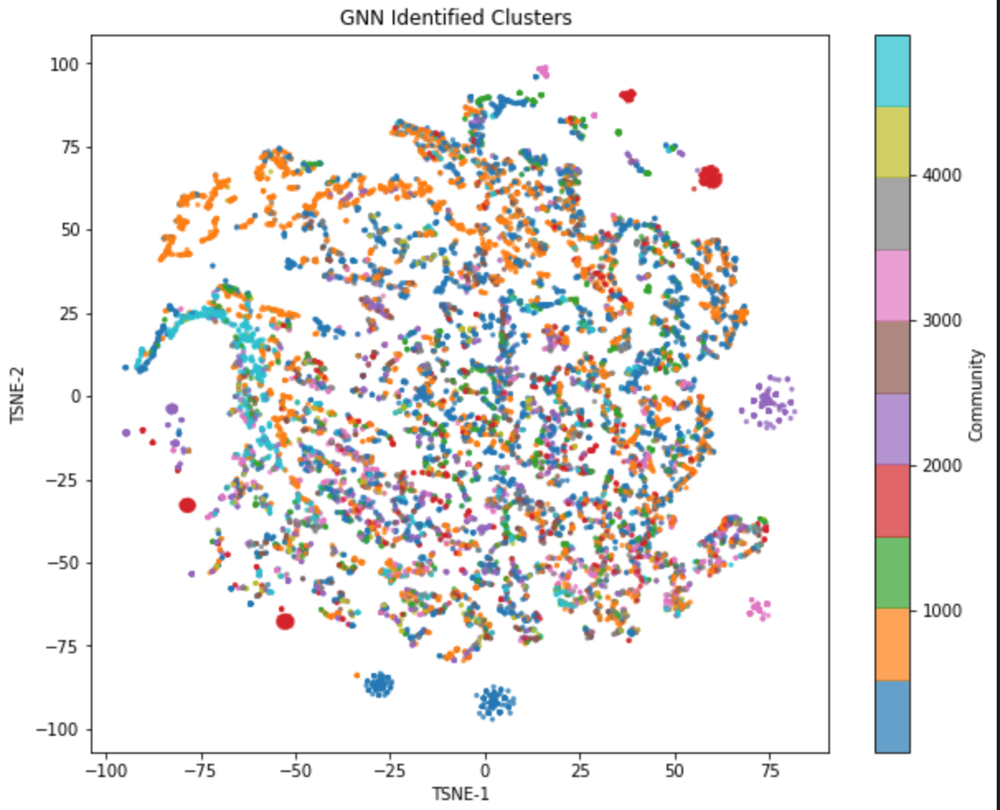

# Community Detection with Graph Neural Networks

This project uses a graph convolutional network (GCN) to find communities in a real co-authorship network, where communities are groups of closely connected researchers. It uses engineered structural node features and evaluates the results against known ground-truth communities.



## Results

The results come from the DBLP network, restricted to the 100 largest ground-truth communities (948 nodes, 2,852 edges).

| Metric | Score |
|---|---|
| Normalized Mutual Information (NMI) | **0.916** |
| Adjusted Rand Index (ARI) | 0.566 |
| Macro F1 | 0.524 |
| Validation accuracy (held-out 20% of nodes) | ~0.61 |

The notebook's printed accuracy of 0.78 is computed over all nodes, including the training nodes. The held-out validation accuracy above is the fairer measure.

**Takeaways**
- **Features matter more than model size.** With random node features, validation accuracy stayed under 10%. Switching to engineered structural features raised it to about 61%.
- **The metrics disagree, so no single number tells the whole story.** The high NMI shows that the overall community structure is captured. The lower ARI and F1 show that exact community memberships are harder to get right.

## Data

The data is the [SNAP](https://snap.stanford.edu/data/#communities) ground-truth community datasets from Stanford:
- **DBLP** co-authorship network (317,080 nodes, 1,049,866 edges), used for the results above
- The Amazon and YouTube networks are also in `data/` for future experiments

## Method

1. **Subgraph.** Load the full graph and keep only the nodes in the top 100 ground-truth communities.
2. **Features.** Compute 7 standardized structural features for each node: degree, clustering coefficient, PageRank, core number, average neighbor degree, degree × clustering, and relative degree.
3. **Model.** Two `GCNConv` layers with batch normalization and dropout (0.4), followed by a linear classifier. Training uses Adam with weight decay.
4. **Training.** An 80/20 train/validation split of nodes, with early stopping on validation loss.
5. **Evaluation.** NMI, ARI, accuracy, and macro F1, plus a t-SNE visualization of the learned embeddings.

## Repository structure

```
notebooks/2__layer_GCN_batchnorm_with_7_features.ipynb   Main experiment
src/model.py                                              GCN model and early-stopping trainer
src/visualization.py                                      t-SNE cluster plot
data/                                                     SNAP graphs and ground-truth communities
figures/                                                  Saved plots
```

## Run it

```bash
git clone https://github.com/evan-nyhus18/GNN-community-detection.git
cd GNN-community-detection
pip install -r requirements.txt
jupyter notebook notebooks/2__layer_GCN_batchnorm_with_7_features.ipynb
```

Before running, update the `graph_file` and `top_5000_file` paths in the notebook's second cell to point at `data/`.

## Next steps

- Compare against classic baselines: Louvain, label propagation, and Girvan–Newman.
- Test how well the model generalizes to the Amazon and YouTube networks.

**Tech stack:** Python, PyTorch, PyTorch Geometric, NetworkX, scikit-learn, matplotlib
